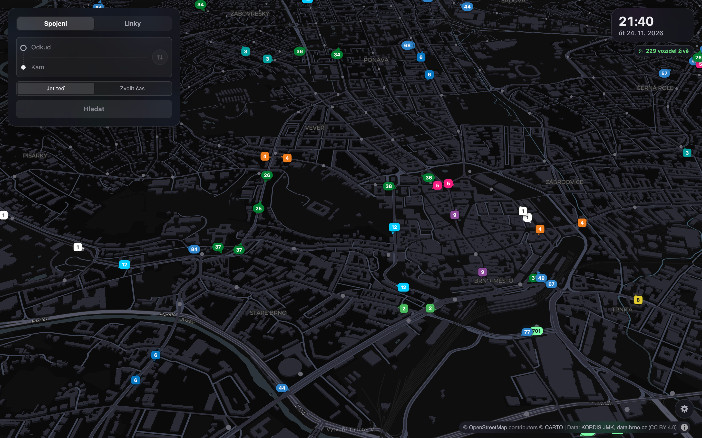
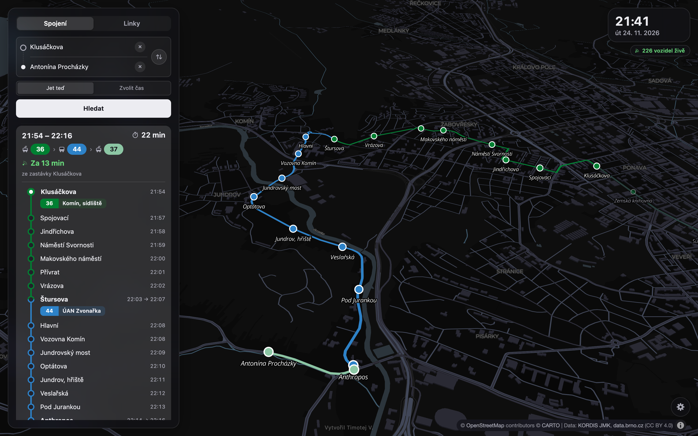
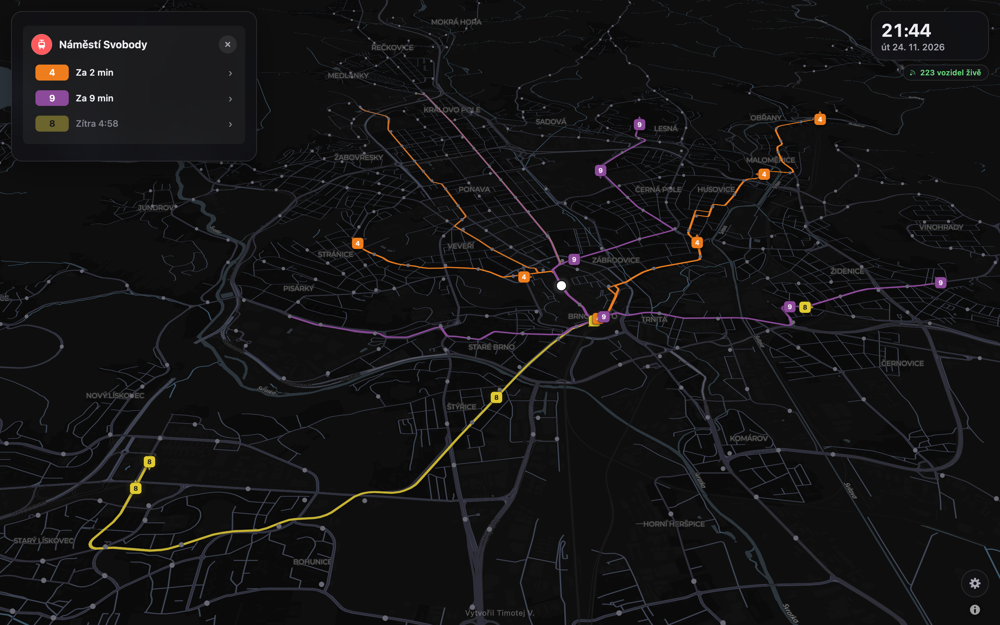
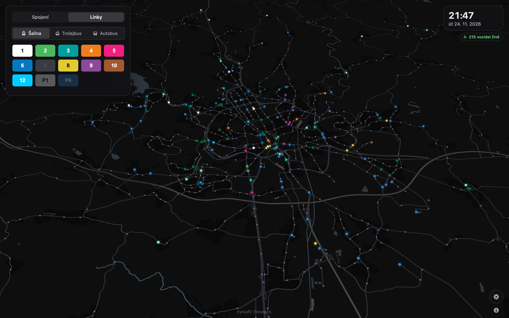
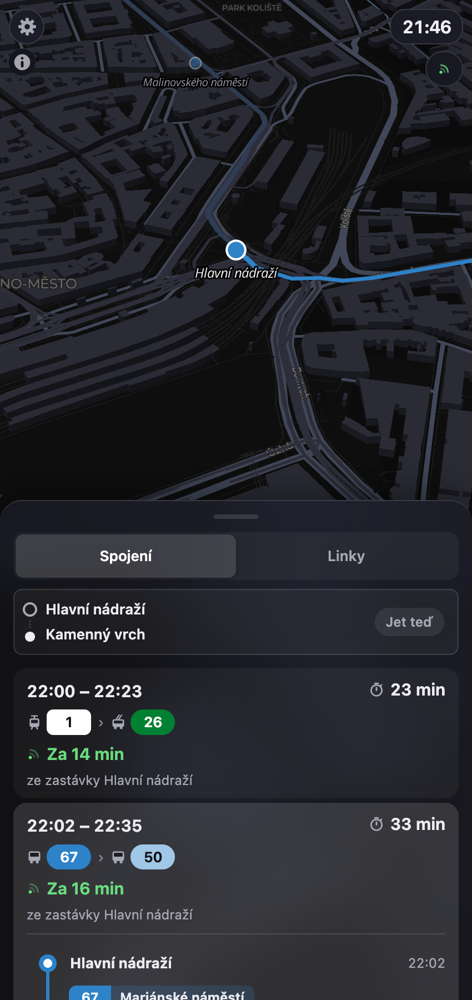
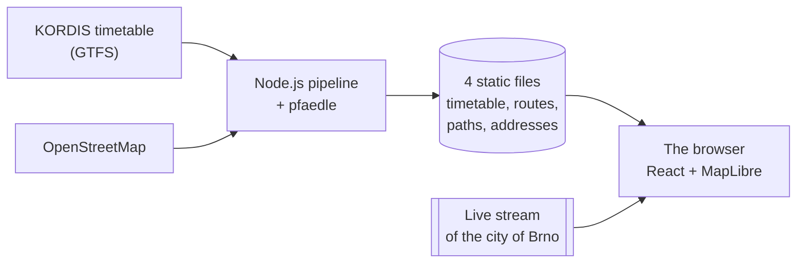

<div align="center">

# ŠalinaGO

**Brno's trams, trolleybuses and buses - live on a 3D map,<br/>with a journey planner that rides along with you.**

[](https://github.com/timotejvas/SalinaGO/actions/workflows/ci.yml)


### [Open the app → salinago.cz](https://salinago.cz)

<!-- the hero video: on github.com, edit this file, drag the .mp4 in here and keep the link it gives on its own line -->



</div>

## Why

Brno publishes its timetable and a live stream of where every vehicle is - but no app shows
them the way you actually travel: _which tram do I take, where is it right now, and when do I
change?_ ŠalinaGO puts the two together, in the browser, without a server.

## What it does

- 🚋 **Every vehicle, live.** About 420 trams, trolleybuses and buses glide along their real
  routes - not jumping every ten seconds, but where they most likely are right now.
- 🧭 **From anywhere to anywhere.** A stop or any of 120 000 addresses in Brno; direct lines or
  up to two changes, with the walks in between.
- 📍 **It rides along with you.** Pick a way and the app follows your vehicle stop by stop - and
  as you near a change, shows the next one coming for you.
- 🗺️ **Every line at a glance.** Its route, how often it runs, every stop with its departures,
  and its vehicles moving between them.
- 📱 **Made for the phone.** A sheet you pull and flick, a search that folds out of the way, in
  Czech and in English.

## Screenshots

<p align="center">
  
  
</p>
<p align="center">
  
  
</p>
<p align="center"><sub>A journey with two changes · A station and every route through it · The whole city live · On a phone</sub></p>

## How it works



1. **Prepared once.** Node.js scripts turn the official timetable and OpenStreetMap into four
   static files: stations, lines, trips and their routes; the paths to walk along; the
   addresses. GitHub checks for a new timetable every hour and rebuilds them by itself.
2. **Worked out in your browser.** There is no backend. The browser loads those files, connects
   to the city's WebSocket stream and does everything else itself: searching, routing,
   predicting where each vehicle is, following your ride.
3. **One rule in the code.** _Logic prepares it, a hook hands it over, a layer draws it._ The
   logic has no React and no map, so all of it runs under plain Node, without a browser.

<details>
<summary><b>The project at a glance</b></summary>

```
frontend/src/
├── logic/      data in, data out - timetable, journeys (RAPTOR), live vehicles, walking
├── hooks/      React that draws nothing - the stream, the ways found, where you are on the way
├── ui/         what you see - the panel, the cards, the corners, settings
├── map/        MapLibre - the basemap, 3D buildings, stations, routes, vehicles, camera
└── styles/     one set of design tokens for type, spaces, colours and motion
frontend/scripts/   the data pipeline     docs/   the details
```

Every file, the data flow and the whole story of the refactor: **[docs/ARCHITECTURE.md](./docs/ARCHITECTURE.md)**.

</details>

## Hard problems, solved

| Challenge                                                                                                                                  | How it was solved                                                                                                                                                                                                                     |
| ------------------------------------------------------------------------------------------------------------------------------------------ | ------------------------------------------------------------------------------------------------------------------------------------------------------------------------------------------------------------------------------------- |
| **The live data is always late.** A position comes every 10.1 s and is 1.8 s old - drawn as it is, every vehicle jumps and shows the past. | Each vehicle is predicted along its route at its own speed, brakes before a stop and never passes one it has not reached; the dot glides after that guess. The biggest change of speed between two frames fell from 10.5 to 0.47 m/s. |
| **500 moving vehicles choked the map** at 38-53 frames a second.                                                                           | Measured, not guessed: redrawn on every frame, and every label laid out again each time. Now 30 redraws a second and labels as HTML elements - **160-175 fps**.                                                                       |
| **The timetable has no routes**, only stations - nothing to draw a line along.                                                             | Every trip laid onto the real tracks and streets of OpenStreetMap with pfaedle, then checked: 98.7 % of the tram routes lie within 15 m of the official network.                                                                      |
| **"Which tram is mine?"** The stream does not say which trip a vehicle runs.                                                               | Matched by route and time, then remembered by its number; 3 stops before a change, the next vehicle is found and shown coming.                                                                                                        |
| **A journey planner with no server.**                                                                                                      | RAPTOR with up to two changes and walks along 218 000 points of OpenStreetMap paths, all in the browser; each change moved as late as the same trips allow.                                                                           |
| **A web page that feels like an app on a phone.**                                                                                          | A sheet that follows the finger, a panel that stays above the iPhone keyboard, fields that do not zoom the page, a camera that keeps the panel's room free.                                                                           |
| **A timetable that changes without notice.**                                                                                               | GitHub checks every hour and, when a new one is out, downloads it, builds it and deploys it - no computer needed; the old one stays if anything fails.                                                                                |
| **Safe by default.**                                                                                                                       | A strict Content Security Policy, nothing from outside inserted as HTML, no cookies, a security audit in CI.                                                                                                                          |

More than thirty fixes, each as _problem → cause → solution_: [docs/ARCHITECTURE.md](./docs/ARCHITECTURE.md#fixes-and-refactoring).

## Tech stack


| Layer         | Technology                                               | What it does here                                                             |
| ------------- | -------------------------------------------------------- | ----------------------------------------------------------------------------- |
| Interface     | React 19, TypeScript (strict), plain CSS with tokens     | the panel, the cards and the phone sheet                                      |
| Map           | MapLibre GL JS 6, CARTO dark-matter vector tiles         | the 3D city, the routes and the vehicles, drawn with WebGL                    |
| Live data     | WebSocket                                                | the stream of every vehicle's position, straight into the browser             |
| Algorithms    | RAPTOR, Dijkstra, own motion model                       | journeys with changes, walks from an address, smooth live vehicles            |
| Data pipeline | Node.js, pfaedle in Docker, a hand-written `.pbf` reader | the timetable, the routes and the walking paths, built in advance             |
| Quality       | oxlint, Prettier, GitHub Actions                         | types, formatting and a security audit on every push; deploys to GitHub Pages |

## Quick start

Requires Node.js 22.18 or newer.

```bash
git clone https://github.com/timotejvas/SalinaGO.git
cd SalinaGO/frontend
npm install
npm run dev          # http://localhost:5173
```

The prepared timetable is in the repository, so the app runs straight away.

<details>
<summary><b>All commands</b></summary>

Run from `frontend/`.

| Command               | What it does                                                          |
| --------------------- | --------------------------------------------------------------------- |
| `npm run dev`         | starts the app on http://localhost:5173, reloading as you edit        |
| `npm run build`       | checks the types and builds the app into `dist/`                      |
| `npm run preview`     | serves the built `dist/` to try it                                    |
| `npm run lint`        | checks the code for common mistakes (oxlint)                          |
| `npm run format`      | formats all code the same way (Prettier)                              |
| `npm run data:update` | downloads a new timetable when KORDIS has one and builds it all again |

_Report a problem_ needs a [Web3Forms](https://web3forms.com) key: put the line
`VITE_REPORT_KEY=<your key>` into `frontend/.env.local`. Building the data again needs Docker and OpenStreetMap - see
[docs/DATA.md](./docs/DATA.md#updating).

Every push to `main` is checked and put online on GitHub Pages
(`.github/workflows/deploy.yml`).

</details>

## Documentation

| Document                                       | What is in it                                                                              |
| ---------------------------------------------- | ------------------------------------------------------------------------------------------ |
| [docs/ARCHITECTURE.md](./docs/ARCHITECTURE.md) | every feature in depth, every file, the data flow, all fixes as problem → cause → solution |
| [docs/DATA.md](./docs/DATA.md)                 | the data sources and their licences, how accurate and how current it is, privacy           |

## Status

**Version 1.0.3 - live at [salinago.cz](https://salinago.cz).** Every push to `main` goes online by
itself, and so does every new timetable.

## Licence and credits

Code: **MIT**, see [LICENSE](LICENSE). Data: KORDIS JMK (CC BY 4.0), data.brno.cz. Routes, paths
and addresses © OpenStreetMap contributors (ODbL). Basemap © OpenStreetMap contributors, © CARTO.

<div align="center">

Made by **Timotej Vaško** · [LinkedIn](https://www.linkedin.com/in/timotejvasko/)

</div>
