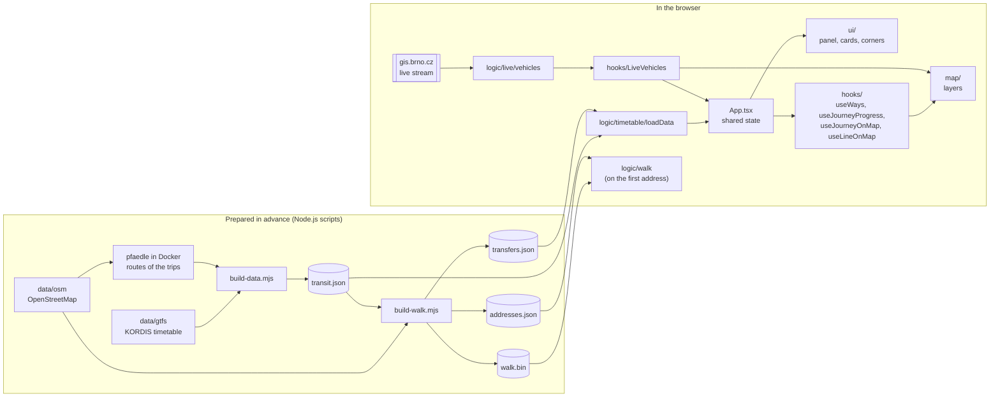
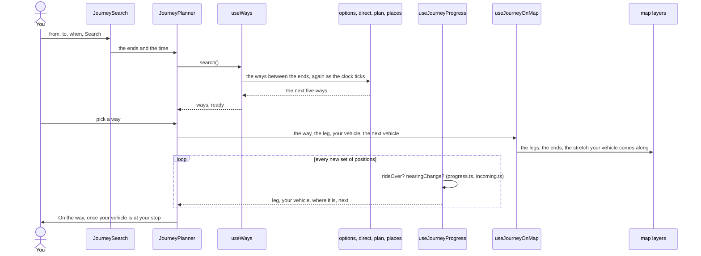

# How ŠalinaGO works

<sub>← [Back to the README](../README.md) · [Data, sources and licences](./DATA.md) · ŠalinaGO 1.1</sub>

The engineering side of the app: how every feature works underneath, how the code is laid out
and how its parts talk to each other, and what was fixed on the way to 1.0.

**Contents:** [Features in depth](#features-in-depth) · [Architecture](#architecture) ·
[Fixes and refactoring](#fixes-and-refactoring) · [Code conventions](#code-conventions)

## Features in depth

Every feature in two halves: **what it does for you**, and **how it works** underneath.

<details open>
<summary><b>🧭 Journey planner</b></summary>

| Feature                      | What it does for you                                                                                                              | How it works                                                                                                                                                                                                                        |
| ---------------------------- | --------------------------------------------------------------------------------------------------------------------------------- | ----------------------------------------------------------------------------------------------------------------------------------------------------------------------------------------------------------------------------------- |
| **From and to**              | Type part of a stop name or an address and pick one of the matches. The swap button turns the ends round.                         | `logic/timetable/stations.ts` searches the 848 stations, `logic/walk/addresses.ts` about 121 000 addresses ("Hybešova 17"; either of the two Czech house numbers works). The addresses are downloaded only once something is typed. |
| **Addresses as ends**        | Start or end anywhere in Brno, not only at a stop.                                                                                | `logic/walk/places.ts` walks from the address along the paths of OpenStreetMap (Dijkstra, `graph.ts`) to the 4 nearest stations within 1.2 km (2.5 km when there are none), at 1.3 m/s. The walk counts in the time of the journey. |
| **When**                     | _Leave now_, or pick a day and a time to **leave at** or to **arrive by**.                                                        | `LeaveWhen.tsx`; only the days the timetable covers can be picked. Arrive-by searches back in steps of 20 min, up to 2 h 40 min. Live information keeps the real clock, so a plan for the evening does not claim a tram in 4 min.   |
| **Ways found**               | The next five ways, the one that gets you there first on top: direct lines and ways with one or two changes, walks included.      | `logic/journey/options.ts` puts direct rides (`direct.ts`) together with RAPTOR (`plan.ts`, 3 rounds = up to 2 changes), asked again from just after each way it found, so the list is not five copies of the fastest one.          |
| **Changes that make sense**  | You change as late as the same trips allow - not dropped at a stop while your tram drives on the same way.                        | After RAPTOR, every change is moved later along the same trips. A change in place is given 2 min, or the measured walk between its platforms where that is longer (`transfers.json`).                                               |
| **Live departures**          | Every way says "in 3 min", "arriving" or "2 min late" for its first vehicle.                                                      | `logic/journey/incoming.ts` finds a vehicle of the line on the route before your stop, for departures within 30 min. The stream does not say which trip a vehicle runs, so it is matched by route and time, never by a trip id.     |
| **A way picked**             | The map draws it: each leg in its colour, the platforms where you get on and off, the stops with their times; the camera fits it. | `hooks/useJourneyOnMap.ts` → `highlightLayer.ts` (the legs grow from the start) and `journeyLayer.ts` (the two ends). The grey station dots are hidden while a way is drawn; on a phone the camera points at the first stop.        |
| **Feedback while searching** | "Finding the way on foot…" while the walking paths download; "No connection found" with a hint when nothing goes there.           | `hooks/useWays.ts` holds what was asked, what is shown and whether it is ready; the planner shows a loading row until it is.                                                                                                        |

</details>

<details open>
<summary><b>🚋 On the way - live tracking of your ride</b></summary>

| Feature                          | What it does for you                                                                                                                                                                               | How it works                                                                                                                                                                                       |
| -------------------------------- | -------------------------------------------------------------------------------------------------------------------------------------------------------------------------------------------------- | -------------------------------------------------------------------------------------------------------------------------------------------------------------------------------------------------- |
| **Your vehicle coming**          | Before you board, the way shows the vehicle coming for you, live on the map and in the strip.                                                                                                      | `hooks/useJourneyProgress.ts` looks for it until 5 min after the timetable's time and then **remembers it by its number**, so it never jumps to the next vehicle of the same line.                 |
| **The riding view**              | Once your vehicle is at your stop, the panel shows _On the way_: your way alone, with the stops still to come.                                                                                     | `ui/journey/OnTheWay.tsx`. Its title says where your vehicle is: at your stop, on the way, or - at a change - which line you change to and when it comes.                                          |
| **The next vehicle at a change** | 3 stops before you change (6 min by the timetable without live data), the vehicle of the next ride appears, coming along its route.                                                                | `logic/journey/progress.ts` → `nearingChange` decides when; `useJourneyOnMap` draws the stretch the next vehicle comes along.                                                                      |
| **Switching rides**              | After the change, the strip and the map switch to the next ride by themselves.                                                                                                                     | `rideOver`: your vehicle has reached the stop where you get off (without live data: a minute after the timetable has you there) - the progress moves to the next leg.                              |
| **A vehicle at a stop**          | A vehicle standing at a stop is drawn on that stop in the strip, not between two.                                                                                                                  | `ui/journey/JourneyStrip.tsx` places each vehicle after the last stop it passed, or on the stop it stands at.                                                                                      |
| **Arrival**                      | When the last ride is over the panel says **You're there** with a tick (or **The rest on foot · N min**), then closes by itself a minute later and is back at the search; × closes it at any time. | `useJourneyProgress` → `arrived`; `JourneyPlanner` closes it after `THERE_MS` (plus the walk). The way is kept at least 10 min past the timetable (`ARRIVED_S`), so a late vehicle never loses it. |

</details>

<details>
<summary><b>🗺️ Lines, stations and vehicles</b></summary>

| Feature                     | What it does for you                                                                                                                                        | How it works                                                                                                                                                                                                   |
| --------------------------- | ----------------------------------------------------------------------------------------------------------------------------------------------------------- | -------------------------------------------------------------------------------------------------------------------------------------------------------------------------------------------------------------- |
| **Line picker**             | Tram, trolleybus or bus, then the line number; the lines that do not run now are faded.                                                                     | `ui/lines/LinePicker.tsx`, `logic/timetable/lines.ts`: a line runs when one of its trips is on the way or starts within the hour.                                                                              |
| **Line overview**           | Where it runs, "every 8 min", "today 4:52-22:22", the next departures, both directions, all stops with their departures and the live vehicles between them. | `ui/lines/LineOverview.tsx`, `logic/timetable/departures.ts`. The main route is the longest one at least 20 % of the trips take; the other routes are drawn under it, so every vehicle stands on a drawn line. |
| **A stop picked**           | Click a stop in a line's strip: its departures, and on the map the stop springs up as a white dot in the line's colour.                                     | `markStop` in `highlightLayer.ts`, from `useLineOnMap` (`picked`).                                                                                                                                             |
| **Station card**            | Click a station: every line that stops there with its next departure, the ones within the hour first.                                                       | `ui/StationCard.tsx`; on the map `stationsLayer.ts` marks it with a white dot and `routesLayer.ts` grows every route through it out of it, both ways at once.                                                  |
| **Vehicle card**            | Click a vehicle: its line, where it goes, its delay and the stops still ahead with the time it is there - the vehicle moving down the strip as it drives.   | `ui/VehicleCard.tsx`, `logic/live/trip.ts`; `routesLayer.followRouteAhead` cuts the route ahead exactly where the vehicle is drawn, every 50 ms, only ever forwards.                                           |
| **A vehicle over its line** | A vehicle opened from a line shows only the route still ahead of it; the line comes back when the card closes.                                              | `useLineOnMap` (`covered`) takes the line off while something is open over it, without moving the camera.                                                                                                      |

</details>

<details>
<summary><b>📡 The live map</b></summary>

| Feature                      | What it does for you                                                                                          | How it works                                                                                                                                                                                                                                          |
| ---------------------------- | ------------------------------------------------------------------------------------------------------------- | ----------------------------------------------------------------------------------------------------------------------------------------------------------------------------------------------------------------------------------------------------- |
| **Every vehicle, live**      | About 420 vehicles at rush hour, each on its route, moving smoothly instead of jumping every 10 s.            | `logic/live/vehicles.ts` keeps the latest message of each vehicle, `track.ts` snaps GPS onto the route, `motion.ts` works out where it is **now** (positions come 10.1 s apart and 1.8 s old) - never past its next stop, braking over the last 30 m. |
| **Dots that become labels**  | Zoomed out, a dot per vehicle; zoomed in, the line number in its colour with a dart pointing where it drives. | `vehiclesLayer.ts` (WebGL dots, 30 redraws a second, 20 on touch screens) and `vehicleLabels.ts` (HTML markers from zoom 13.5, 14.2 on touch screens, their size shared through CSS variables).                                                       |
| **Your vehicle pings**       | The vehicle of your journey sends out a ring, so that you find it at a glance.                                | A copy of its label grows and fades; off for reduced motion.                                                                                                                                                                                          |
| **3D Brno**                  | Buildings rise from the basemap; zooming out they sink and fade instead of blinking out.                      | `map/basemap/buildings3D.ts`; `trimBasemap.ts` hides far-away towns, countries and borders.                                                                                                                                                           |
| **The network**              | A faint line of every route in the background, always the network of the current timetable.                   | `networkLayer.ts` draws `networkPaths` (all variants), calculated from OpenStreetMap by pfaedle.                                                                                                                                                      |
| **Live status**              | The corner says "354 vehicles live", "connecting …" or "not answering"; on a phone a small circle you tap.    | `ui/Corner.tsx`. The stream is connected again 5 s after it drops; a vehicle not heard of for 2 min is removed.                                                                                                                                       |
| **Only vehicles in service** | A vehicle that has finished its trip, drives to the depot or is outside Brno is not shown.                    | `inService` in `logic/live/trip.ts`, applied in `hooks/LiveVehicles.tsx`; see [DATA.md](./DATA.md#live-vehicles).                                                                                                                                     |

</details>

<details>
<summary><b>📱 Phone, accessibility and settings</b></summary>

| Feature                         | What it does for you                                                                                                                                             | How it works                                                                                                                                                                                                                                                              |
| ------------------------------- | ---------------------------------------------------------------------------------------------------------------------------------------------------------------- | ------------------------------------------------------------------------------------------------------------------------------------------------------------------------------------------------------------------------------------------------------------------------- |
| **A sheet you pull**            | On a phone the panel is a bottom sheet: pull it, flick it or tap its handle; it settles low, at half or all the way up - three heights, as a phone's own sheets. | `ui/panel/usePanelDrag.ts` (touch on its head, or on its content scrolled to the top; a flick is faster than 0.4 px/ms; a rubber band at the ends) and `control.ts` (`HEIGHT` = 14, 50 and 92 % of the screen; all the way up it reaches from under the phone's top bar). |
| **Glides, never jumps**         | Whatever opens or closes, the panel's height glides to its new size.                                                                                             | `ui/panel/usePanelHeight.ts`: a ResizeObserver and a Web Animations height animation (380 ms, the curve of an iOS sheet; on a phone a spring with a little bounce, 540 ms).                                                                                               |
| **Above the keyboard**          | One tap on a field: the panel rises all the way up as the keyboard comes; what is in it stays above the keyboard.                                                | `Panel.tsx` focuses the field itself, without a scroll; `ui/panel/useKeyboard.ts` measures the visual viewport into `--keyboard` and `--view-top`.                                                                                                                        |
| **The search folds**            | After Search, the two ends and the time fold into one row, so that the ways get the screen.                                                                      | `ui/journey/JourneySearch.tsx`; a tap opens it again.                                                                                                                                                                                                                     |
| **No zoom on a field**          | The page does not zoom in when you tap a field, and pinch-zoom still works.                                                                                      | Fields are 16 px on phones (13 px elsewhere): the size at which phones stop zooming in.                                                                                                                                                                                   |
| **Keyboard and screen readers** | A visible focus ring on everything you can press, labels on the icon buttons, Escape closes Settings.                                                            | `:focus-visible` in `styles/page.css` (not on the map canvas); `aria-label`s from `logic/words.ts`.                                                                                                                                                                       |
| **Less motion**                 | If your system asks for less motion, nothing animates.                                                                                                           | `screen.ts` → `lessMotion()`, asked by the panel, the map and the vehicles.                                                                                                                                                                                               |
| **Two languages**               | Czech and English; a browser in Czech or Slovak starts in Czech.                                                                                                 | `ui/language.ts` (remembered in this browser); every word is in `logic/words.ts`.                                                                                                                                                                                         |
| **Settings**                    | The language, the timetable's publication date, the live connection, the sources, _Report a problem_, the version.                                               | `ui/Settings.tsx`; `ui/Report.tsx` sends what you write with what you have open (mode, line or ends, version, screen, browser) to Web3Forms.                                                                                                                              |
| **Keyboard in Settings**        | Tab goes round the buttons and fields of Settings, not on to the map; closing it puts the focus back on the gear.                                                | `Settings.tsx` keeps the focus in the pane.                                                                                                                                                                                                                               |
| **Loading screen**              | A small line with stops that draws itself while the map, the timetable and the vehicles load, saying what it waits for.                                          | `ui/LoadingScreen.tsx`; it fades out when all three are there, or leaves the error with _Try again_.                                                                                                                                                                      |

</details>

---

## Architecture

### The one rule

Everything on the map takes the same way: **logic prepares it, a hook hands it over, a layer
draws it.** No file does two of these.

| Part                 | Decides                                        | Does not                         |
| -------------------- | ---------------------------------------------- | -------------------------------- |
| `logic/`             | _what_ is shown (data, calculations)           | know the map or React            |
| `hooks/`             | links logic with the layers that keep changing | draw anything in the panel       |
| `map/…Layer.ts`      | _how_ it looks (colours, sizes, animations)    | read `transit.json` or calculate |
| `map/setupLayers.ts` | links logic with the layers drawn once         |                                  |
| `ui/`                | what you see in the panel and the corners      | calculate                        |
| `styles/theme.css`   | the colours, type, spaces and curves of motion |                                  |
| `screen.ts`          | what screen it is: a phone, touch, less motion |                                  |

Because `logic/` has no React and no map, all of it runs under plain Node, without a browser
and without a build - the data pipeline uses parts of it the same way.

### Data flow



**State lives in one place per question.** `App.tsx` keeps only what two parts of the page
need: the timetable, the map, the clock, the chosen line, the live vehicles, the ends of the
journey and which vehicles the map shows. Everything else stays where it is used: the ways
found in `useWays`, where you are on the way in `useJourneyProgress`, the height of the panel in
`Panel`.

<details>
<summary><b>A journey, step by step</b></summary>



</details>

<details>
<summary><b>The live stream, step by step</b></summary>

1. `hooks/LiveVehicles.tsx` calls `watchVehicles` as soon as the timetable is here - before the
   map is ready, because the first burst of the whole fleet is worth starting to wait for early.
2. `logic/live/vehicles.ts` reads each message: only lines that are in the timetable, only
   finite coordinates. The position is snapped onto the route of its line (`track.ts`) and its
   motion is updated (`motion.ts`).
3. Every 2 s the changed fleet is handed over: to `App`, because the line panel and the journey
   use it, and to the map (`setVehicles`), all of it or only the chosen line, the lines of an
   opened station or the vehicles of your journey.
4. `map/transit/vehiclesLayer.ts` draws, 30 times a second, where each vehicle most likely is
   **now**. The dot chases that place along the route: a correction is a short glide, never a
   jump, and never backwards.

</details>

### Project structure

```
SalinaGO/
├── .github/workflows/
│   ├── ci.yml                   every push: npm audit, Prettier, oxlint, types and build
│   ├── deploy.yml               every push to main: build, publish on GitHub Pages
│   └── update-data.yml          every hour: a new timetable? download, build, commit, deploy
├── data/
│   ├── gtfs/                    the official KORDIS timetable (.txt) and SOURCE.json, its version - not in git
│   ├── osm/                     OpenStreetMap of Czechia, for the routes and walking (not in git)
│   └── shapes/                  pfaedle's output, the routes of the trips (generated, not in git)
├── docs/
│   ├── ARCHITECTURE.md          this file: features in depth, structure, fixes
│   ├── DATA.md                  data sources, licences, how current, accuracy checks
│   └── screenshots/             the images of the README
└── frontend/                    the app; every command is run from here
    ├── index.html               the page: viewport for notched phones, theme colour
    ├── vite.config.ts           React, the version, relative paths, the security policy and the
    │                            visit counter of the build
    ├── public/                  what the app downloads: transit.json, transfers.json, walk.bin, addresses.json;
    │                            the icons, manifest.webmanifest and og-image.jpg (a shared link's picture)
    ├── scripts/                 the data pipeline (Node.js)
    └── src/
        ├── logic/               data in, data out - no React, no map
        ├── hooks/               React that draws nothing
        ├── ui/                  what you see
        ├── map/                 MapLibre: the map, its layers, the camera
        └── styles/              the design tokens and the page
```

<details>
<summary><b>📁 <code>src/</code> - the files at its root</b></summary>

| File         | What it is                                                                                                                                                                                           |
| ------------ | ---------------------------------------------------------------------------------------------------------------------------------------------------------------------------------------------------- |
| `main.tsx`   | The entry point: starts React and imports the two global stylesheets.                                                                                                                                |
| `App.tsx`    | The page: the map, the panel with its two modes, the live vehicles, the clock, the loading screen and errors. Holds the state two parts of the page share; starts downloading the timetable at once. |
| `screen.ts`  | What kind of screen it is: `isPhone()` (600 px wide or less), `isTouch()`, `lessMotion()`, `usePhone()`, `visibleHeight()` and the shared `EASE` curve. The panel and the map both ask here.         |
| `colors.ts`  | The colours of the lines from the timetable, made readable on a dark map; the map and the panel both draw in them.                                                                                   |
| `version.ts` | The version of the app from `package.json` (`1.0.0` shown as `1.0`), put in by Vite.                                                                                                                 |

</details>

<details>
<summary><b>📁 <code>src/logic/</code> - the data and the decisions</b></summary>

| File             | What it answers                                                                                                                                |
| ---------------- | ---------------------------------------------------------------------------------------------------------------------------------------------- |
| `words.ts`       | Every word the app says, in English and in Czech, with Czech plurals (1 vozidlo, 2 vozidla, 5 vozidel).                                        |
| **`timetable/`** |                                                                                                                                                |
| `loadData.ts`    | Downloads `transit.json`, and `transfers.json` merged into it when it is there; the types of the data.                                         |
| `clock.ts`       | The time in Brno as the timetable counts it, past midnight included; dates and times in words.                                                 |
| `departures.ts`  | Whether a route runs now, its next trips from any station, when it runs today and how often.                                                   |
| `lines.ts`       | The kinds of the lines, which numbers are offered and which run, directions, routes, the other ends and stops, the paths of the whole network. |
| `stations.ts`    | The stations for the map and the search, and the stops of one route at their platforms.                                                        |
| **`journey/`**   |                                                                                                                                                |
| `direct.ts`      | Rides from one station to another without a change, grouped by line.                                                                           |
| `plan.ts`        | RAPTOR: journeys with up to two changes and walks; every change moved as late as the trips allow.                                              |
| `options.ts`     | The ways a search offers: the next five of any kind, to leave at or to arrive by a time.                                                       |
| `leg.ts`         | The part of a route you are on: its stops and the piece of the route between them.                                                             |
| `stops.ts`       | A journey as the list of stops you pass, with their times, as the board in a tram shows it.                                                    |
| `incoming.ts`    | The live vehicle coming to pick you up: on the route before your stop, how far, how late; `describeComing` ("arriving", "in 3 min").           |
| `progress.ts`    | Where you are on a picked way: `rideOver`, `nearingChange`, `reachedOff`, `stopsToOff`.                                                        |
| **`live/`**      |                                                                                                                                                |
| `vehicles.ts`    | The WebSocket stream: reading the messages, keeping the fleet, connecting again; delays in words.                                              |
| `track.ts`       | Snapping positions onto the routes of their line; the way along a route between two positions.                                                 |
| `motion.ts`      | Where a vehicle most likely is now: an even speed, braking before a stop, never past the next stop.                                            |
| `trip.ts`        | The trip a vehicle is on, as far as the stream tells it: its route, where it is on it, the time to each stop ahead.                            |
| **`walk/`**      |                                                                                                                                                |
| `load.ts`        | Downloads `walk.bin` and `addresses.json`, once, when they are first needed.                                                                   |
| `graph.ts`       | The graph of the paths you can walk along, and Dijkstra over it.                                                                               |
| `addresses.ts`   | Finding an address by what is typed, by either Czech house number.                                                                             |
| `places.ts`      | The ends of a journey - a station or an address - and the walks from an address to the stations near it.                                       |

</details>

<details>
<summary><b>📁 <code>src/hooks/</code> - React that draws nothing</b></summary>

| File                    | What it keeps or links                                                                                                         |
| ----------------------- | ------------------------------------------------------------------------------------------------------------------------------ |
| `MapView.tsx`           | Creates the map while the timetable downloads, puts the timetable on it when both are there, says when it is ready or failed.  |
| `LiveVehicles.tsx`      | Connects to the stream, hands the vehicles to `App` and draws the ones it is given on the map.                                 |
| `useWays.ts`            | The ways between the two ends once Search is pressed: found again as the clock ticks; the picked one kept while you are on it. |
| `useJourneyProgress.ts` | Which ride you are on, your vehicle (remembered by its number), where it is, and the next vehicle near a change.               |
| `useJourneyOnMap.ts`    | What a journey puts on the map and takes off again, and which vehicles the map shows during it.                                |
| `useLineOnMap.ts`       | What a chosen line puts on the map: its route, its other routes under it, and the camera.                                      |
| `useWalking.ts`         | The walking data: the same download for every part that asks for it.                                                           |

</details>

<details>
<summary><b>📁 <code>src/ui/</code> - what you see</b></summary>

| File                                                         | What it shows                                                                                                            |
| ------------------------------------------------------------ | ------------------------------------------------------------------------------------------------------------------------ |
| **`panel/`**                                                 |                                                                                                                          |
| `Panel.tsx` + `.css`                                         | The panel: top left on a wide screen, a bottom sheet on a phone; the switch between the modes; what is opened over them. |
| `control.ts`                                                 | The heights (`HEIGHT`), `movePanel()`, `scrollPanelTo()`, the nearest and the next height.                               |
| `usePanelDrag.ts`                                            | Dragging and flicking with a finger on its head or its content; dragging and tapping the handle with a mouse.            |
| `usePanelHeight.ts`                                          | The glide of the height between two contents.                                                                            |
| `useKeyboard.ts`                                             | The panel above a phone's keyboard.                                                                                      |
| `ModeContent.tsx`                                            | A mode kept drawn, out of sight, under what is opened, so that coming back it is as you left it.                         |
| **`journey/`**                                               |                                                                                                                          |
| `JourneyPlanner.tsx` + `.css`                                | Puts the planner together: the search, the list of ways, the riding view.                                                |
| `JourneySearch.tsx` + `.css`                                 | From, to, when, Search; on a phone the folded row.                                                                       |
| `PlaceField.tsx` + `.css`                                    | One end: the field and its matches, stops with their lines and addresses with a pin.                                     |
| `LeaveWhen.tsx` + `.css`                                     | Now, or leave at or arrive by a day and a time.                                                                          |
| `JourneyWay.tsx` + `.css`                                    | One way as a card: the times, the lines, the walks, the live departure; picked, its stops.                               |
| `JourneyStrip.tsx`                                           | The stops of a journey for the strip, with the changes, the walks and the live vehicles.                                 |
| `OnTheWay.tsx` + `.css`                                      | The riding view: its title, the change line, the stops still to come.                                                    |
| `KindIcon.tsx` + `.css`                                      | A tram, a trolleybus, a bus or walking, as a small picture.                                                              |
| **`lines/`**                                                 |                                                                                                                          |
| `LinePicker.tsx` + `.css`                                    | The kind, then the line number.                                                                                          |
| `LineOverview.tsx` + `.css`                                  | A line: its route, frequency, departures, directions, stops and live vehicles.                                           |
| **beside them**                                              |                                                                                                                          |
| `StationCard.tsx` + `.css`                                   | A station opened on the map.                                                                                             |
| `VehicleCard.tsx`                                            | A vehicle opened on the map.                                                                                             |
| `Strip.tsx` + `.css`                                         | A strip of stops - a line through circles, rows beside them - for lines, journeys and vehicles alike.                    |
| `Corner.tsx` + `.css`, `Clock.tsx` + `.css`, `LiveWaves.tsx` | The clock and the live status at the top right, the gear at the bottom right.                                            |
| `Settings.tsx` + `.css`, `Report.tsx`                        | Settings and reporting a problem.                                                                                        |
| `LoadingScreen.tsx` + `.css`                                 | The loading screen.                                                                                                      |
| `MadeBy.tsx` + `.css`                                        | "Made by Timotej V." at the foot of the map, linking to LinkedIn.                                                        |
| `language.ts`                                                | The chosen language and `useWords()`.                                                                                    |

</details>

<details>
<summary><b>📁 <code>src/map/</code> - MapLibre</b></summary>

| File                               | What it draws or does                                                                                |
| ---------------------------------- | ---------------------------------------------------------------------------------------------------- |
| `settings.ts`                      | The basemap, where the map opens, how far it may be moved, its pitch, the attribution.               |
| `createMap.ts`, `setupMapLibre.ts` | Creating the map; telling MapLibre where its worker file is.                                         |
| `setupLayers.ts`                   | Adds every layer in drawing order.                                                                   |
| `camera.ts`                        | The entrance, and fitting a line, a journey or a station - keeping the room of the panel free.       |
| `labelFont.ts`                     | The basemap's own font for our labels.                                                               |
| **`basemap/`**                     |                                                                                                      |
| `buildings3D.ts`                   | 3D buildings that sink and fade as you zoom out.                                                     |
| `trimBasemap.ts`                   | Hides what Brno does not need: far-away towns, countries, borders.                                   |
| **`transit/`**                     |                                                                                                      |
| `networkLayer.ts`                  | The faint network of all lines.                                                                      |
| `stationsLayer.ts`                 | The grey station dots; a click opens one (a white dot). Hidden while a journey is drawn.             |
| `routesLayer.ts`                   | The routes growing out of an opened station, or the route ahead of a vehicle, cut where it is drawn. |
| `highlightLayer.ts`                | A highlighted route with its stops: a line, or the legs of a journey.                                |
| `journeyLayer.ts`                  | The two ends of a journey.                                                                           |
| `vehiclesLayer.ts`                 | The live vehicles as dots with halos, moved 30 times a second.                                       |
| `vehicleLabels.ts` + `.css`        | The labels of the vehicles as HTML markers, with their dart and the ping.                            |

</details>

<details>
<summary><b>📁 <code>src/styles/</code> and <code>scripts/</code></b></summary>

| File                      | What it is                                                                                                                                                                                                                                   |
| ------------------------- | -------------------------------------------------------------------------------------------------------------------------------------------------------------------------------------------------------------------------------------------- |
| `styles/theme.css`        | The design tokens: the sizes of type, the spaces, the radii, the colours (`--ink`, `--ink-dim`, `--ink-faint`, `--late`, `--brand`, `--error`, `--focus` …) and the four curves of motion `--ease`, `--ease-in-out`, `--settle`, `--spring`. |
| `styles/page.css`         | The page, the map and its credits, the error box, the scrollbars, the focus ring, the feedback of a press, the segmented control, the line badge, the live waves.                                                                            |
| `scripts/build-data.mjs`  | GTFS and pfaedle's routes → `public/transit.json`.                                                                                                                                                                                           |
| `scripts/build-walk.mjs`  | OpenStreetMap → `walk.bin`, `addresses.json` and `transfers.json`.                                                                                                                                                                           |
| `scripts/update-data.mjs` | Downloads a new GTFS when KORDIS publishes one and builds everything again; puts the old files back when anything fails.                                                                                                                     |
| `scripts/gtfs/*.mjs`      | Reading the GTFS: the calendar, the stations, the variants, the transfers, the routes, running pfaedle.                                                                                                                                      |
| `scripts/osm/pbf.mjs`     | Reads an OpenStreetMap `.pbf` file without any library (zlib and Protocol Buffers by hand).                                                                                                                                                  |

</details>

### Security and privacy

- **A Content Security Policy** in the built page (`vite.config.ts`): scripts only from the app
  itself, connections only to the CARTO basemap, the live stream, Web3Forms and the visit
  counter. A script that
  slipped in could neither run inline nor send anything away - both were tested and blocked.
- **No cookies.** The only thing kept in the browser is the chosen language. Visits are counted
  only when the site is built with a token for Cloudflare Web Analytics, which keeps no cookies
  and nothing about who you are.
- **Nothing from outside is put in as HTML.** The messages of the stream are checked (known lines,
  finite coordinates) and shown as text.
- **Report a problem** sends only what you write, an email if you give one, and what you have
  open. The key of the form is public by design; the address the reports go to is set at
  Web3Forms, never in the code.
- **CI** runs `npm audit --audit-level=high`, with permission only to read the code.

---

## Fixes and refactoring

Every entry: **Problem** → **Cause** → **Solution**.

<details>
<summary><b>🚋 The live vehicles and the map</b></summary>

| Problem                                                                          | Cause                                                                                                                                                                                            | Solution                                                                                                                                                                                                                                       |
| -------------------------------------------------------------------------------- | ------------------------------------------------------------------------------------------------------------------------------------------------------------------------------------------------ | ---------------------------------------------------------------------------------------------------------------------------------------------------------------------------------------------------------------------------------------------- |
| Vehicles showed the past - 2 to 12 s behind - and pulsed with each new position. | The time a position was taken (`TimeUpdated`) was thrown away, and each dot glided from its previous position to the new one.                                                                    | `logic/live/motion.ts` works out where the vehicle is **now** along its route; never shown beyond its next stop, and standing at a stop it is drawn on the platform.                                                                           |
| Vehicles surged: slow, lurch, slow, lurch, every 10 s.                           | The guess doubted itself from the first second, and the dot took a share of the distance in each frame, so its speed changed in a single frame.                                                  | An even speed is trusted for as long as the next position takes (10.1 s, measured); braking over the last 30 m before a stop; the dot has a speed of its own that changes gently (the biggest change in one frame fell from 10.5 to 0.47 m/s). |
| The app ran at 38-53 frames a second, with frames of 68 ms.                      | The vehicles were drawn again on every animation frame (180 a second on a fast screen), and the labels sat in the source of the dots, so every redraw laid out every symbol again (about 20 ms). | 30 redraws a second; the labels in a source of their own, written only when needed → 160-175 frames a second, no frame over 22 ms.                                                                                                             |
| Labels stepped visibly when zoomed in.                                           | They were symbols of a map layer, laid out again on every change, so they could only move twice a second.                                                                                        | HTML markers moved with the dots in every frame (`vehicleLabels.ts`).                                                                                                                                                                          |
| Zooming on a phone stuttered as the dots turned into labels.                     | About 300 label elements on a phone's screen at zoom 13.5, each written in every frame.                                                                                                          | Labels from zoom 14.2 on touch screens, 20 redraws a second, their size through shared CSS variables, an element written only when it changes.                                                                                                 |
| A route drawing itself was not smooth.                                           | Each frame rewrote the source that also held the stops and their names: 20 ms of laying out names in every frame.                                                                                | The stops have a source of their own, written once.                                                                                                                                                                                            |
| The line behind a clicked vehicle was erased in the wrong place.                 | It was cut where the stream put the vehicle, not where the vehicle is drawn.                                                                                                                     | `followRouteAhead` cuts it where the vehicle is drawn, every 50 ms, only ever forwards, looking along the route 800 m at a time.                                                                                                               |
| The buildings blinked out at zoom 13.                                            | The basemap has no building outlines below zoom 13.                                                                                                                                              | They sink and fade over the zoom above, so nothing disappears at once.                                                                                                                                                                         |
| On a phone the camera did not move to a line or a journey.                       | `fitBounds` does nothing at all when the padding - the room of the panel - is bigger than the map.                                                                                               | The padding is clamped to what the map can hold.                                                                                                                                                                                               |
| Grey station dots cluttered a picked journey.                                    | All stations stayed drawn under it.                                                                                                                                                              | The station dots are hidden while a journey is drawn.                                                                                                                                                                                          |

</details>

<details>
<summary><b>📱 The panel and the phone</b></summary>

| Problem                                                                    | Cause                                                                                              | Solution                                                                                                                                    |
| -------------------------------------------------------------------------- | -------------------------------------------------------------------------------------------------- | ------------------------------------------------------------------------------------------------------------------------------------------- |
| Switching in the panel, it was first narrower and then widened.            | Its width was set without its padding (`content-box`) while its height glided.                     | `box-sizing: border-box` and a fixed width (354 px) on a wide screen.                                                                       |
| Back on Journey, the cards of the ways came in one by one again.           | A hidden mode was taken off the page and built again.                                              | `ModeContent.tsx` keeps a hidden mode drawn, out of sight; it comes back as one piece.                                                      |
| A phone zoomed the page in when a field was tapped.                        | The fields were 13 px, and phones zoom in on anything under 16 px.                                 | 16 px fields on phones; pinch-zoom kept for everyone who needs it.                                                                          |
| The sheet jumped under the finger and lagged behind it.                    | It moved its top to the finger, and every pixel went through React state, drawing the panel again. | It keeps the distance from where it was taken hold of, writes its height straight onto the element, and sets state once, when it is let go. |
| On an iPhone the panel ended half under the keyboard, with a gap above it. | The keyboard does not make the page shorter.                                                       | `useKeyboard.ts` measures the visual viewport (`--keyboard`, `--screen-1`).                                                                 |
| The search took half the phone's screen after searching.                   | The whole form stayed open.                                                                        | It folds into one row; a tap opens it again.                                                                                                |
| The live status hardly fitted on a phone.                                  | The pane with its full text was too wide.                                                          | A small circle that opens for 4 s when tapped.                                                                                              |
| The room of the panel was measured wrong on phones.                        | The height of the window was used, not the visible height and the named heights of the panel.      | `HEIGHT[...]`, `visibleHeight()` and the height of the page.                                                                                |
| The tram of the loading screen set off three times in two seconds.         | Every arrival started a new eased move.                                                            | An even pace: the moves run into one ride.                                                                                                  |

</details>

<details>
<summary><b>🧭 Journeys and live tracking</b></summary>

| Problem                                                           | Cause                                                                   | Solution                                                                                                                                                  |
| ----------------------------------------------------------------- | ----------------------------------------------------------------------- | --------------------------------------------------------------------------------------------------------------------------------------------------------- |
| The planner only answered "what can I take right now".            | There was no way to choose a time.                                      | Leave at or arrive by a day and a time; the live notes keep the real clock.                                                                               |
| You were dropped at a stop while your tram drove on the same way. | RAPTOR gets off at the first station where the next line can be caught. | Every change is moved as late as the same trips allow.                                                                                                    |
| After a change, the strip and the map stayed on the first ride.   | Only the first ride of a way was followed.                              | `rideOver` moves the progress to the next leg; `useJourneyProgress` keeps the way, your vehicle and the leg, and starts again when another way is picked. |
| Nearing a change, you could not see your next vehicle coming.     | Only the vehicle of the ride you were on was followed.                  | `nearingChange`: 3 stops before the change (6 min without live data) the next vehicle is shown coming along its route.                                    |
| A vehicle waiting at a stop was missing from the strip.           | Vehicles were only placed between two stops.                            | It is drawn on the stop it stands at.                                                                                                                     |

</details>

<details>
<summary><b>🏗️ Structure (the 1.0 refactor) and robustness</b></summary>

| Problem                                                                                                     | Cause                                                      | Solution                                                                                                                                                                                |
| ----------------------------------------------------------------------------------------------------------- | ---------------------------------------------------------- | --------------------------------------------------------------------------------------------------------------------------------------------------------------------------------------- |
| The gear opened Settings before the timetable was there.                                                    | It was always shown.                                       | It is shown once the timetable has loaded.                                                                                                                                              |
| An error while loading left you stuck.                                                                      | It was only a message.                                     | An error box with _Try again_.                                                                                                                                                          |
| A search from an address said nothing while the paths downloaded.                                           | There was no state for it.                                 | A "Finding the way on foot…" row.                                                                                                                                                       |
| `JourneyPlanner` and `Panel` each did several jobs in one file.                                             | They grew feature by feature.                              | Split into `JourneySearch`, `OnTheWay`, `useWays`, `useJourneyProgress` and `progress.ts`; and into `Panel`, `control`, `usePanelDrag`, `usePanelHeight`, `useKeyboard`, `ModeContent`. |
| `stationsLayer.ts` drew the dots and grew the routes.                                                       | Two layers in one file.                                    | `routesLayer.ts` took the routes.                                                                                                                                                       |
| Folder and file names did not say what was inside (`components/`, `connect/`, `network.ts`, `config.ts` …). | They were named after a place, not after what they answer. | `ui/` is what you see, `hooks/` what draws nothing; every file is named after the question it answers.                                                                                  |
| Dead code and CSS.                                                                                          | Left over from earlier versions.                           | Removed (`lateBy`, `leadOf`, `routesOfRide`, `routesServing`, unused classes).                                                                                                          |
| Eight greys, five font sizes, curves and colours written in many files.                                     | Each file decided for itself.                              | One set of tokens in `styles/theme.css`, four curves of motion, and a focus ring everywhere.                                                                                            |
| The map and the panel each asked what screen it was.                                                        | `matchMedia` in several files.                             | One `screen.ts`.                                                                                                                                                                        |
| No defence if a script ever slipped in.                                                                     | No security policy.                                        | A CSP in the build, the report fields limited, `npm audit` in CI, and the update script passes its messages to AppleScript as arguments, never as code.                                 |

</details>

<details>
<summary><b>🔧 Version 1.0.1</b></summary>

| Problem                                                                                                             | Cause                                                                                                 | Solution                                                                                                                                                           |
| ------------------------------------------------------------------------------------------------------------------- | ----------------------------------------------------------------------------------------------------- | ------------------------------------------------------------------------------------------------------------------------------------------------------------------ |
| _Report a problem_ said nothing useful when the form service refused a report.                                      | Only the HTTP status was looked at.                                                                   | The service's answer is read; when it did not take the report, its reason is shown under the message.                                                              |
| Clicking a stop of a line marked it in the strip, but not on the map; in a vehicle's card it was not marked at all. | Nothing on the map listened to the stop picked, and the vehicle card kept no stop picked.             | `markStop`: the stop springs up on the map as a white dot in a ring of the line's colour; the vehicle card picks a stop as the line and the journey do.            |
| A vehicle opened from a line looked as if the route behind it was never taken away.                                 | The whole line stayed drawn under the vehicle's card.                                                 | The line steps aside while something is open over it and comes back when it closes.                                                                                |
| Tab in Settings went on to the map under it.                                                                        | Nothing kept the focus in the pane.                                                                   | The focus goes round inside it and back to the gear when it closes.                                                                                                |
| The time and the day of _Pick a time_ zoomed a phone's page in.                                                     | Their text was 12 px; phones zoom on anything under 16 px.                                            | One rule for every field on a touch screen: 16 px.                                                                                                                 |
| As the keyboard came up, the panel jumped, its top above the screen for a moment.                                   | The keyboard moves the panel's bottom in one step while its height was still gliding to the old size. | A change of the keyboard stops the glide and sizes the panel at once; without a keyboard the panel is sized by `dvh`, which the browser changes in the same frame. |
| A quick flick of the panel ended in a slow glide.                                                                   | Every glide took 380 ms, whatever the finger's speed.                                                 | After a flick the glide is as short as the flick was fast (220-380 ms).                                                                                            |
| Vehicles that had finished their trip still stood on the map.                                                       | Every vehicle sending a position was shown.                                                           | Only vehicles on a trip with a route are shown.                                                                                                                    |
| Regional buses leaving Brno had no stops ahead.                                                                     | Their final stop is outside Brno, on none of our routes.                                              | Their route is the one whose next stretch they are on.                                                                                                             |
| On a late vehicle, the way you were on could vanish before you were there.                                          | It was kept only 2 minutes past the timetable's arrival.                                              | Kept at least 10 minutes, and closed by the app once you really are there.                                                                                         |
| A journey ended without saying so.                                                                                  | There was no "there" state.                                                                           | _You're there_, then the panel closes by itself.                                                                                                                   |
| A shared link showed no picture, and the icon was a plain dot.                                                      | No link preview tags, one small icon.                                                                 | A new icon (a line with stops, as on the loading screen) for tabs, iPhone and Android, a web app manifest, and a link preview image with its tags.                 |

</details>

<details>
<summary><b>🔧 Version 1.0.2</b></summary>

| Problem                                                                                       | Cause                                                                                                                                               | Solution                                                                                                                 |
| --------------------------------------------------------------------------------------------- | --------------------------------------------------------------------------------------------------------------------------------------------------- | ------------------------------------------------------------------------------------------------------------------------ |
| On an iPhone, with the keyboard up, the fields of the panel were above the top of the screen. | An iPhone moves what is seen down the page rather than covering its bottom, so nothing looked covered, and the panel was sized by the whole screen. | The panel is sized by what is seen whenever it is shorter than the page - however the phone makes room for the keyboard. |
| On a phone the (i) of the map credits did not line up with the gear above it.                 | It was smaller (24 px), without a rim, its middle 4 px aside.                                                                                       | A round pane like the gear: 32 px, the same glass and rim, right under it.                                               |

</details>

<details>
<summary><b>🔧 Version 1.0.3</b></summary>

| Problem                                                                                                 | Cause                                                                                                                                                                 | Solution                                                                                                                                                                                                                       |
| ------------------------------------------------------------------------------------------------------- | --------------------------------------------------------------------------------------------------------------------------------------------------------------------- | ------------------------------------------------------------------------------------------------------------------------------------------------------------------------------------------------------------------------------ |
| Tapping a field on a phone, the panel rose and the page moved at the same time - not one smooth motion. | The panel went up only once the field had the focus; by then the phone had seen the field low on the screen, where the keyboard comes, and moved the page to show it. | The panel is laid out all the way up the moment a finger touches a field, before the focus; it is drawn where it was and slides up (a transform, so the layout does not change on the way), and the phone has nothing to move. |
| The top of the panel moved again when the keyboard came.                                                | All the way up was 92 % of what is seen, and the keyboard takes part of it.                                                                                           | All the way up, the top stands at one place under the phone's top bar; the keyboard moves only the bottom.                                                                                                                     |

</details>

<details>
<summary><b>🔧 Version 1.0.4</b></summary>

| Problem                                                                                                     | Cause                                                                                                                                                                              | Solution                                                                                                                                                                  |
| ----------------------------------------------------------------------------------------------------------- | ---------------------------------------------------------------------------------------------------------------------------------------------------------------------------------- | ------------------------------------------------------------------------------------------------------------------------------------------------------------------------- |
| On an iPhone, the map showed between the panel and the keyboard.                                            | The panel ended where the keyboard began, but Safari on iOS 26 floats its address bar and the form bar above the keyboard, over the page - and the map behind them showed through. | All the way up, the panel reaches down to the bottom of the screen, under the keyboard; only its content ends above the keyboard.                                         |
| A square white ring around a field being typed in.                                                          | The browser's own focus outline, drawn around the field itself inside a rounded block.                                                                                             | No outline on text fields; the rounded block around them lights its rim instead, as it does on hover.                                                                     |
| A field took two taps before you could type.                                                                | The panel rose under the finger as it touched the field, and the phone took the tap for nothing.                                                                                   | The tap is the app's: as the finger lifts, the panel rises and the field is focused in the same moment.                                                                   |
| Going from one field to the other, the page jumped a little.                                                | The phone scrolls the page to every field it focuses.                                                                                                                              | The fields are focused without a scroll - they are high on the screen already.                                                                                            |
| As the keyboard went down, the panel coming down to half stopped and jumped.                                | The keyboard going stopped the panel's glide, and half the screen was measured by what the keyboard left.                                                                          | Below all the way up there is no keyboard: the panel takes it down with it, glides to a height the keyboard does not change, and all the way up it glides by its top too. |
| Four heights to pull the panel to, two of them almost the same.                                             | Put away (its handle only) and low (its top) were 5 and 14 % of the screen.                                                                                                        | Three heights, as a phone's own sheets: low, half, all the way up.                                                                                                        |
| The stretch a vehicle comes along was drawn with no vehicle on it.                                          | It was drawn for any vehicle that fitted - also before one was known to be yours, which the map then did not show.                                                                 | Drawn only for the vehicle the map shows as yours.                                                                                                                        |
| On a phone, a line chosen after a stop or a vehicle had been looked at: the camera did not move to it.      | The camera was moved to one place with padding, and MapLibre keeps padding given to a move: every move after it kept that room free on top of its own, more than the map has.      | One place is moved to with an offset, which does not stay.                                                                                                                |
| Picking the first end on a phone, the typing stuttered a little.                                            | The camera flew to the stop behind the panel and the keyboard, where nobody could see it.                                                                                          | While the other end is still being typed, the camera stays; it moves once the panel comes down with both ends.                                                            |
| A shared link showed a sentence for a title, a description, and the name and logo written over its picture. | The link preview was made to say all of it.                                                                                                                                        | Only the name, ŠalinaGO, and the city live in the picture - nothing written over it, no description.                                                                      |

</details>

<details>
<summary><b>🔧 Version 1.1</b></summary>

| Problem                                                                                                                                             | Cause                                                                                                                                                                                                                                  | Solution                                                                                                                                                                                                                        |
| --------------------------------------------------------------------------------------------------------------------------------------------------- | -------------------------------------------------------------------------------------------------------------------------------------------------------------------------------------------------------------------------------------- | ------------------------------------------------------------------------------------------------------------------------------------------------------------------------------------------------------------------------------- |
| A way with a change ended at the stop where you change, though a ride was still to come; a way found from that stop ended the moment it was opened. | Whether a vehicle had got to where you get off was asked only around that stop. A vehicle still coming for you, far away, was nearest to the stretch after it wherever the route bends back, and was taken for one that had passed it. | Where the vehicle is is looked for along the whole ride; at the stop or past it is there, and a vehicle nowhere near that part of the route leaves it to the timetable. A test with a route that bends back.                    |
| Tapping a field, the panel still jumped as it rose.                                                                                                 | The field slid up with the panel, and the phone, seeing it low on the screen where the keyboard comes, moved the whole page to show it.                                                                                                | The keyboard comes up for an unseen field that stands still at the top of the screen; once the panel is up, the typing is handed to the real field, with anything typed meanwhile.                                              |
| The icon.                                                                                                                                           | -                                                                                                                                                                                                                                      | The live dot of the map again, as the first icon was, on a dark tile with a soft light edge, the dot glowing a little.                                                                                                          |
| The loading screen had the version and the author in one line.                                                                                      | -                                                                                                                                                                                                                                      | The version at the foot, and who made it under it.                                                                                                                                                                              |
| A shared link: the logo, a sentence and more over the picture, a sentence for a title.                                                              | -                                                                                                                                                                                                                                      | The city live fading into dark, and on the dark side only the name. The title only ŠalinaGO.                                                                                                                                    |
| The first tap on a field raised the panel, but no keyboard came.                                                                                    | The unseen field that takes the keyboard was put on the page in the same moment it was to take it, and the phone did not give it one.                                                                                                  | It is on the page from the start.                                                                                                                                                                                               |
| The panel still seemed to jump up rather than slide.                                                                                                | The phone shows nothing for the first moment while it brings up the keyboard, and the panel's curve did most of its way in that moment.                                                                                                | A gentler curve, about as long as the keyboard: most of the slide is seen, with the keyboard.                                                                                                                                   |
| The places a field offers ran on under the keyboard, cut off by the edge of the panel, the form under them showing through.                         | The list hung over the panel at its full length.                                                                                                                                                                                       | On a phone it ends a little above the keyboard, its rounded foot in sight, scrolls inside, and is not see-through.                                                                                                              |
| A way you were there on stayed open for a minute, longer with a walk to the end.                                                                    | -                                                                                                                                                                                                                                      | It says so for a moment and closes by itself.                                                                                                                                                                                   |
| Between its three heights the phone's sheet only glided, flat.                                                                                      | -                                                                                                                                                                                                                                      | It springs: a little past the height and back (damping 0.72, 0.54 s), as a phone's own sheets; a flick arrives sooner. Where the browser cannot draw a spring, the old glide.                                                   |
| Nearing a change, the next ride was one more green line under the title, looking just like it.                                                      | -                                                                                                                                                                                                                                      | A card of its own: a round mark in the colour of the line with the arrows of a change, the line as a badge, the stop you get on at, and on the right how soon it is there - green with the live waves when its vehicle is seen. |

</details>

---

## Code conventions

- Every file starts with a short comment that says what the file is for.
- Values you may want to change are at the top of a file, between `// ---------- settings ----------`
  and `// ------------------------------`.
- A function or type that other files use has a comment above it: one or two full sentences.
- Notes inside the code are short, lower-case and without a full stop.
- Inside `src/logic/` imports end with `.ts`, so that Node can run it without a build (the data
  pipeline does).
- The code and its comments are in English; the app speaks Czech and English (`logic/words.ts`).
